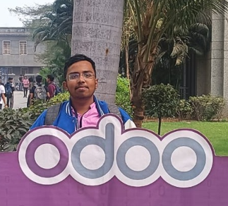
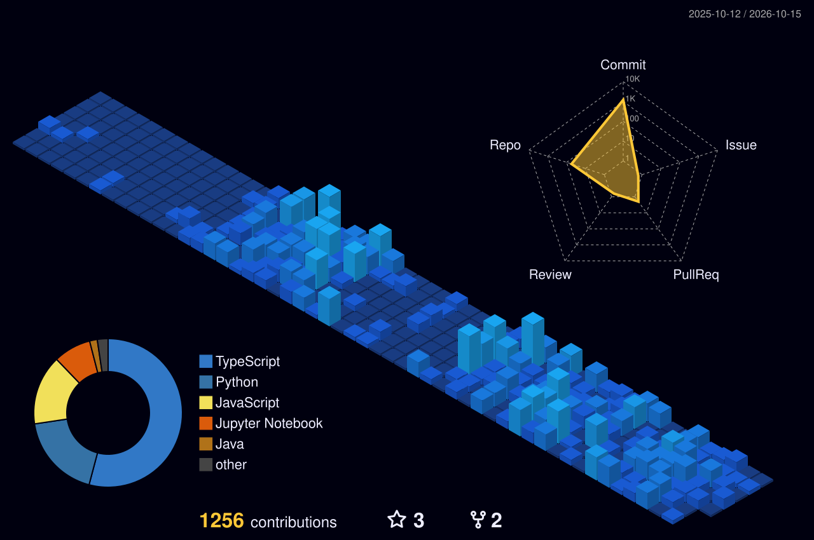

<!-- Profile README for AfzalSurti -->

# Afzal N. Surti

**Software Developer · Backend & Applied AI**

I build backend-heavy business software and LLM-powered tools that real teams use — 
currently at a civil-engineering consultancy, where I design, ship and deploy internal platforms end to end.

---

## About

I'm a final-year B.E. Computer Science student at **The Maharaja Sayajirao University of Baroda** who also works as a software developer. Most of what I build follows the same shape: a messy business process (spreadsheets, WhatsApp threads, shared inboxes) turned into a typed API, a relational schema, role-based workflows and — where it genuinely helps — an LLM step with guardrails.

What I care about as an engineer:

- **Owning the whole path** — schema design and migrations, API layer, frontend, auth, deployment, and the fixes after launch.
- **AI that degrades gracefully** — LLM calls behind validation, rule-based fallbacks, caching, and human approval where mistakes are expensive.
- **Writing down decisions** — architecture notes, decision logs and evaluation reports live next to the code.

## Experience

**Software Developer — Geo Designs & Research Pvt. Ltd., Vadodara** · Mar 2026 – present
 *Civil-engineering consultancy preparing Detailed Project Reports (DPRs) for highway projects.*

- Built **HighwayOps Hub**, the firm's operations platform for DPR projects: tasks and field reports, project finance and RA bills, expenses, assets, tenders, and an LLM assistant that turns chat requests into validated actions.
- Built **MailDesk** (shared-inbox management with AI categorisation and a RAG assistant), an **attendance system** (selfie + GPS check-in from a mobile app) and a **road-maintenance issue platform** with web and mobile clients for a highway operations client.
- Built internal AI agents, including a travel-booking agent for engineers' survey trips and document-processing agents that turn engineering drawings and site photos into structured outputs.
- Deploy and maintain these services on a Linux VPS (nginx, PM2) and on managed platforms (Render, Vercel, Neon PostgreSQL).

**Full-Stack Web Developer Intern — Enlighten Infosystem** · May 2025 – Jul 2025

---

## Featured Projects

### 🏗️ [HighwayOps Hub](https://github.com/AfzalSurti/roadway-ops-hub) — operations platform for highway DPR projects
Replaces spreadsheet-driven tracking for a consultancy's project, finance and admin teams.
- Layered Express API (routes → controllers → services → repositories) with **~180 route handlers**, Zod validation, Helmet, rate limiting and structured logging
- **43-model Prisma schema** on PostgreSQL; short-lived JWTs plus hashed, revocable refresh tokens; **8-role RBAC** and an audit log
- LLM assistant (Groq) that plans actions such as *create task* or *list pending work*, asks for missing fields, and falls back to a rule-based planner when no model is available

`TypeScript` `Node.js` `Express` `Prisma` `PostgreSQL` `React` `TanStack Query`

### 📬 [MailDesk](https://github.com/AfzalSurti/MailDesk) — AI shared inbox for a company team
- Gmail **IMAP sync** with background jobs; **hybrid categorisation** — keyword rules settle obvious emails, batched LLM calls classify the rest
- **RAG assistant** over the inbox using **pgvector**, isolated per user and per mailbox, with an exact-match + semantic answer cache keyed to the inbox state
- Fernet-encrypted mailbox credentials, multi-key LLM failover, per-user chat rate limits; deployed on a VPS behind nginx with PM2

`Python` `FastAPI` `async SQLAlchemy` `PostgreSQL + pgvector` `React` `Zustand`

### 🛣️ [RoadService](https://github.com/AfzalSurti/RoadService) — road-maintenance issue management (web + mobile)
- Defect lifecycle across **Government, Admin, Contractor and Surveyor** roles: surveyors raise and verify issues in the field, contractors resolve them, admins manage, government gets a read-only view
- FastAPI backend with **24 Alembic migrations**, a scheduled status-transition job (APScheduler), PDF exports, billing and document-approval modules
- React + TypeScript web dashboards and a React Native (Expo) field app sharing one API

`Python` `FastAPI` `SQLAlchemy` `Alembic` `PostgreSQL` `React` `Expo`

### 🎫 [AI Travel Booking Agent](https://github.com/AfzalSurti/railway) — deterministic backend for an agentic booking flow
- Provider abstraction for train, bus and flight search, a Playwright browser layer and a **BullMQ + Redis** job queue
- **Human-in-the-loop by design**: CAPTCHAs, OTPs and payment authentication are always handed back to a person
- Natural-language search with a rule-based parser; an optional LLM only fills **Zod-validated slots** and has no tool access

`TypeScript` `Express` `Prisma` `BullMQ` `Playwright` `Vitest`

### 🧑‍💼 [AI Recruitment & Resume Screening](https://github.com/AfzalSurti/airesume) — three-service hiring platform
- React app, Express API and a separate **FastAPI AI service** for resume/JD parsing, embeddings and LLM evaluation
- **pgvector** matching of job descriptions against a resume pool, evidence-based screening, and a hiring pipeline from document collection to offer letter
- Multi-tenant organisations with JWT auth and five roles

`Node.js` `Express` `FastAPI` `PostgreSQL + pgvector` `React`

### 📍 [Attendance Management System](https://github.com/AfzalSurti/Attendence_Management_System) — selfie + GPS attendance
- Employees check in and out from a mobile app with a front-camera selfie, GPS coordinates and an assigned project
- FastAPI backend with role-based access for employees, developers and admins; attendance history and reports

`Python` `FastAPI` `SQLAlchemy` `PostgreSQL` `React Native (Expo)` `Cloudinary`

---

## More Work

| Project | What it shows | Stack |
|---|---|---|
| [Hiver](https://github.com/AfzalSurti/Hiver) | Support agent built **evaluation-first**: 228-example golden set, baselines, rule-based escalation policy, failure analysis | Python, scikit-learn, LLMs |
| [NookalIntegration](https://github.com/AfzalSurti/NookalIntegration) | Clinic automation where an **approval queue is the only path to sends and writes**, plus a kill switch, idempotent messaging and an audit log | Python, FastAPI |
| [ATCC](https://github.com/AfzalSurti/ATCC) | Video traffic counting and vehicle classification with YOLOv8 + ByteTrack, React upload UI, ONNX export | Python, OpenCV, React |
| [RAG_pipeline](https://github.com/AfzalSurti/RAG_pipeline) | Multi-format document RAG with chunking, FAISS and cited answers | Python, LangChain, FAISS |
| [clara](https://github.com/AfzalSurti/clara) | CLARA and PAM (k-medoids) from scratch in pure Python — no NumPy — with a tested public API | Python |
| [Mini_C_Compiler](https://github.com/AfzalSurti/Mini_C_Compiler) | Lexer → parser → semantic analysis → IR → LLVM IR → native execution | Python, LLVM |
| [CSV-IMPORTER](https://github.com/AfzalSurti/CSV-IMPORTER) | LLM maps arbitrary CSV layouts onto a fixed CRM schema, with live SSE progress | Next.js, TypeScript, Docker |
| [QuantProjects](https://github.com/AfzalSurti/QuantProjects) | Rule-based AAPL signal research, backtesting and risk analysis | Python, pandas |
| [VisionTransformer](https://github.com/AfzalSurti/VisionTransformer) · [LLM-From-Scratch](https://github.com/AfzalSurti/LLM-From-Scratch) | Implementing ViT, attention and language-model building blocks to understand them | PyTorch |

<b>Hackathons and earlier projects</b>

 

- [Budget-Accounting-System---Shiv-Furniture](https://github.com/AfzalSurti/Budget-Accounting-System---Shiv-Furniture) — team ERP for budgets, invoicing and orders (Next.js, Prisma)
- [OdooXGCET](https://github.com/AfzalSurti/OdooXGCET) — Zarvo HRMS, Odoo × GCET hackathon
- [SIH](https://github.com/AfzalSurti/SIH) — CycloneAI, Smart India Hackathon
- [Amazon-ML-Challenge-2025](https://github.com/AfzalSurti/Amazon-ML-Challenge-2025) — product pricing, team CodeConquer
- [AmazonRecommender](https://github.com/AfzalSurti/AmazonRecommender) · [Image_Retrival](https://github.com/AfzalSurti/Image_Retrival) — semantic product search; CLIP + FAISS image retrieval
- [wa_auto_reply](https://github.com/AfzalSurti/wa_auto_reply) · [Festival_Greeting](https://github.com/AfzalSurti/Festival_Greeting) · [Instagram](https://github.com/AfzalSurti/Instagram) — messaging and social automation
- [SystemProgramming](https://github.com/AfzalSurti/SystemProgramming) — C log monitor with an Express dashboard
- [surti-farsaan](https://github.com/AfzalSurti/surti-farsaan) — PHP/MySQL e-commerce site
- Contributed to [SpringERP](https://github.com/AfzalSurti/SpringERP) (fork of a Spring Boot ERP)

---

## Skills

Grouped by how I've actually used them; the first row is what my day-to-day work runs on.

| | |
|---|---|
| **Daily use** | Python, TypeScript, JavaScript · FastAPI, Node.js/Express · React · PostgreSQL · Prisma, SQLAlchemy · REST API design, JWT auth, RBAC |
| **AI / LLM** | LLM integration (OpenRouter, Groq, OpenAI-compatible APIs) · RAG with pgvector and FAISS · embeddings · structured-output validation · evaluation sets and baselines · LangChain |
| **ML** | NumPy, pandas, scikit-learn, Matplotlib · PyTorch (study projects) · OpenCV, YOLOv8 |
| **Also used** | Java, C, C++ · Next.js · React Native (Expo) · Tailwind CSS · MySQL, MongoDB · Redis/BullMQ · Playwright, Vitest, pytest |
| **Deploy & tools** | Git/GitHub · Linux VPS with nginx and PM2 · Render, Vercel, Neon · Docker (basic) |

## Currently

- **Building:** an AI agent system to automate stages of highway DPR preparation, with engineers approving each step.
- **Learning:** RAG evaluation (retrieval metrics, LLM-as-judge), agent orchestration patterns, system design, and CI/CD with GitHub Actions.

## Achievements

- **Top 79 / 750+ teams** — Odoo Hackathon (offline round) · **On-site qualifier** — MumbaiHacks · **Top 10 / 85+ teams** — university hackathon
- **CGPA 8.69** — B.E. Computer Science · **GUJCET rank 605**

---

**Open to** software developer, backend and AI/ML engineering roles.
 
📧 [surtiafzal915@gmail.com](mailto:surtiafzal915@gmail.com) · 💼 [LinkedIn](https://www.linkedin.com/in/afzal-surti-9904b2287/) · 🌐 [Portfolio](https://afzal-surti.vercel.app/)

